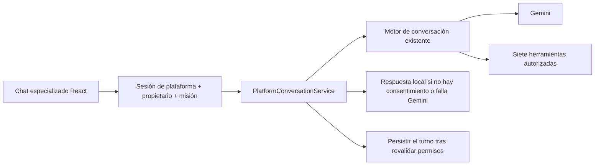

# Quirón: conversaciones especializadas con Gemini

## Base revisada

Se actualizaron las referencias de GitHub antes de editar:

- Frontend `origin/main`: `cba8fd8`.
- Backend `origin/master`: `52b38ae`.

Sus árboles no mostraban diferencias respecto al código relevante de las ramas locales de roles. No se crearon commits, pushes ni despliegues.

## Causa y cambio principal

Salud física y Bienestar emocional enviaban sus mensajes a `PlatformService.postConversationMessage`, que ejecutaba `composeQuironReply`. Esa función repetía el texto de la persona dentro de una plantilla y añadía fuentes genéricas. Nunca llamaba al proveedor ni utilizaba el historial para responder.

El endpoint de mensajes mantiene su dirección y ahora lo atiende `PlatformConversationController`. `PlatformConversationService` reutiliza `AiService` y el bucle de `SpaceConversationService` mediante un adaptador interno de autorización. No hay un segundo proveedor ni un octavo tool.



La apertura local se conserva porque todavía no existe consentimiento para enviar datos al modelo. Los mensajes posteriores pueden utilizar Gemini al autorizarlo. Cada respuesta conserva su fuente real: modelo o motor local, herramientas consultadas y aviso de fallo cuando corresponde.

## Consentimiento y contexto

- El consentimiento del chat general no se hereda al modo especializado. Cada conversación inicia con Gemini desactivado.
- Se autoriza por separado enviar el mensaje, incluir historial y utilizar registros propios.
- El historial se obtiene en el servidor del ID de conversación autorizado; el cliente no puede introducir otra conversación ni otra persona. Máximo: 12 mensajes, 2.000 caracteres por mensaje y 12 KB de historial UTF-8.
- Sin permiso de historial, no se envían turnos anteriores al proveedor. El motor local puede continuar dentro de la conversación guardada sin enviar nada fuera.
- El perfil debe ser propietario de la conversación y mantener una membresía activa. Se comprueba antes de consultar herramientas y antes de guardar el resultado.
- Las respuestas tardías se descartan en la interfaz al cancelar o cambiar de contexto. Los turnos concurrentes se bloquean y la persistencia detecta cambios de revisión.

## Evidencia y siete herramientas

Se conservan `getRecentSleep`, `getLatestVitals`, `getVitalTrends`, `getMeasurementQuality`, `getActiveHealthAlerts`, `getMissionContext` y `getSupportOptions`, con argumentos vacíos y sin acciones de escritura.

- Los registros propios de descanso y síntomas se obtienen mediante los servicios existentes de plataforma, solo con consentimiento de datos.
- Las mediciones del simulador requieren vincular la sesión de astronauta del mismo perfil y el PIN existente. El token sigue caducando a los 15 minutos y se revoca al desvincular o cerrar los controles. Un token de otro astronauta se rechaza antes de llamar al proveedor.
- Si el contexto del simulador todavía pertenece a otro perfil o rol, la vinculación se bloquea y se ofrece revisar la sesión en Tripulación. No se cambia el rol ni se salta el PIN automáticamente.
- Los datos de plataforma y del simulador se distinguen: un intervalo de sueño autorreportado no se presenta como una medición clínica en vivo.
- `hrMin` y `hrMax` describen la referencia basal, no mínimos y máximos observados. Una tendencia no establece su causa.
- Ante 429, ausencia de configuración o errores del proveedor, la respuesta se etiqueta como local. Cuando existe autorización, el motor local puede consultar las mismas herramientas y explicar valores reales disponibles; no atribuye esas llamadas a Gemini.

El motor determinista de salud y sus umbrales permanecen. Las reglas locales de seguridad por texto se extrajeron a un recurso compartido sin cambiar los patrones y ahora se aplican también en los modos especializados. No son un detector fiable de emergencias y no activan notificaciones ni comparten información automáticamente.

## Revisión humana

1. La persona solicita un borrador.
2. Se resume lo que relató en esta conversación, con historial acotado. Para enviarlo a Gemini hacen falta consentimiento de modelo e historial; si no, se genera localmente.
3. El borrador se muestra editable y no se almacena como compartido. No agrega automáticamente el expediente ni nuevas mediciones.
4. La persona elige un profesional activo de su misión y pulsa **Aprobar y compartir este resumen**.
5. El servidor vuelve a validar propietario, membresía, destinatario y revisión del diálogo.

El profesional elegido puede leer el texto aprobado en su panel. No obtiene el chat completo. El jefe, otro profesional no elegido y otros astronautas no reciben ese resumen. No se envían notificaciones ni se crean citas.

## Contratos y compatibilidad

Los esquemas se mantienen sincronizados en `shared/careSchema.ts` y `src/ai/care.contract.ts` del backend.

| Endpoint | Comportamiento |
|---|---|
| `POST /api/platform/missions/:id/quiron` | Conserva `mode`; añade `locale` opcional, por defecto español. |
| `POST /api/platform/quiron/:id/message` | Conserva `text`; añade idioma, consentimiento y vinculación opcional. Clientes anteriores permanecen en modo local. |
| `POST /api/platform/quiron/:id/summary/draft` | Nuevo borrador, sin compartir. |
| `POST /api/platform/quiron/:id/summary` | Aprobación explícita; valida destinatario profesional y admite `expectedMessages` para detectar un borrador obsoleto. |
| `GET /api/platform/missions/:id/quiron-summaries` | Devuelve resúmenes aprobados propios o dirigidos al profesional autenticado, nunca mensajes privados completos. |

Los cambios necesitan estar presentes en ambos proyectos para usar todas las funciones nuevas. No se actualizaron los servicios de producción.

## Verificación

- Frontend: 131 pruebas aprobadas; build y TypeScript aprobados.
- Backend: 183 pruebas aprobadas en 18 suites; TypeScript aprobado.
- Navegador: nueve pruebas aprobadas, incluyendo los cuatro roles, aislamiento del hilo privado, consentimiento especializado, edición/aprobación y lectura del resumen por el profesional elegido, y chat general/público.
- Lint de los archivos cambiados aprobado. El lint general conserva los dos errores preexistentes documentados en la integración de roles.

La evaluación real usa Gemini `gemini-3.5-flash-lite`, con los servicios nuevos, conversaciones sintéticas y un almacén temporal aislado. No utiliza historiales reales ni imprime credenciales.

Ejemplos reales tras los ajustes:

| Usuario | Gemini |
|---|---|
| «Me siento mal» | «Lamento que te sientas mal. ¿Sientes que es algo físico, emocional o una combinación de ambos?» |
| «Físico» | «Comprendo. ¿Podrías contarme qué es lo que te molesta o qué síntomas físicos estás experimentando?» |
| «Dolor de cabeza» | «Siento que tengas dolor de cabeza. ¿Cuándo empezó a molestarte?» |
| “Headache” | “I am sorry to hear you are dealing with a headache. When did it start?” |

La evaluación confirmó continuidad ante «Física» y un cambio explícito de tema hacia las órbitas. Un borrador generado después resumió el malestar físico y el dolor de cabeza en lugar de contestar de nuevo la pregunta de ciencia. En inglés, resumió los síntomas sin diagnosticarlos.

La prueba de tendencia consultó `getVitalTrends` y distinguió 104 lpm simulados, referencia individual 64–76 lpm, diferencia de 28 lpm respecto al límite superior y 31 muestras utilizables, sin atribuir una causa.

También se observaron fallos reales 429 y de red. Se documentan como fallos del proveedor, no como éxitos de Gemini. La última prueba aislada de calidad del sensor produjo una respuesta local con la herramienta autorizada: antigüedad de 0 minutos y calidad del 98%; no validó una respuesta completa de Gemini para ese caso. En Bienestar emocional, dos turnos y el resumen fueron de Gemini; el turno de detener la charla utilizó el fallback local ante un error de red. No se ocultaron estos resultados ni se elevaron permisos para evitarlos.

En la primera evaluación real se detectaron un borrador que continuaba la charla, un cambio de idioma y una confusión entre rango basal y observaciones. Se corrigieron y se repitieron los casos pertinentes. Las comprobaciones automáticas de repetición y tono son heurísticas; los resultados no garantizan ausencia de errores en toda conversación futura.

## Reproducir

```powershell
# Frontend
npm test
npm run build
npm exec -- playwright test e2e/care-specialized.spec.ts e2e/roles-integration.spec.ts e2e/quiron-dialogue.spec.ts

# Gemini real: requiere credenciales autorizadas en el backend hermano
node scripts/quiron-care-live-eval.mjs --group=symptoms
node scripts/quiron-care-live-eval.mjs --group=symptoms-en
node scripts/quiron-care-live-eval.mjs --group=emotions
node scripts/quiron-care-live-eval.mjs --group=evidence

# Backend
npm test -- --runInBand
```

El registro completo de las ejecuciones sintéticas queda localmente en `artifacts/quiron-care-live-eval.jsonl`, ignorado por Git. El evaluador termina con código distinto de cero cuando un caso depende del fallback o no cumple sus comprobaciones: no presenta una caída del proveedor como una validación exitosa del modelo.
